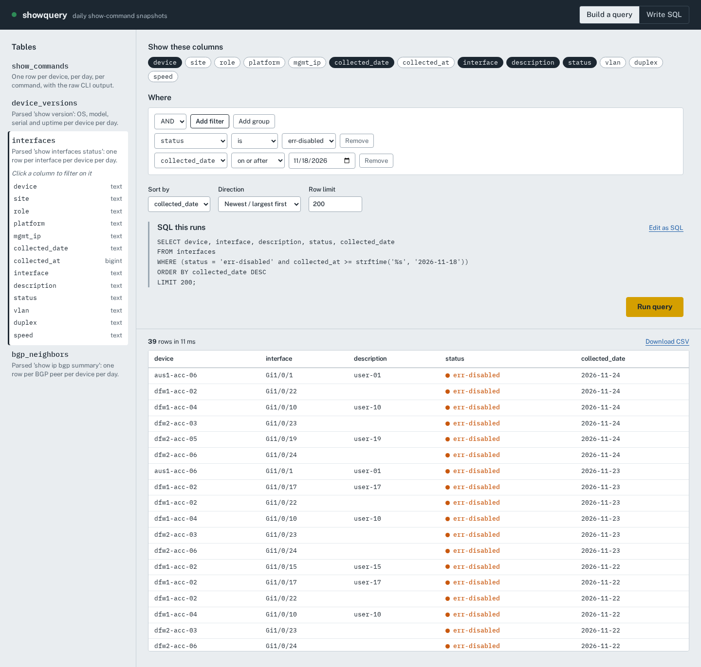

# showquery-lab

An experiment in making daily network `show` command snapshots queryable by
everyone. Data stays in MongoDB. Users query it with SQL through osquery, or with
a point-and-click query builder that writes the SQL for them.



## How it fits together

```
 browser ──► FastAPI (/api/query) ──► osqueryd ──► showquery extension ──► MongoDB
  │  React Query Builder              SQLite engine   one virtual table       show_commands
  │  or CodeMirror SQL                (read-only,      per catalog entry,      (one doc per
  └─ both send plain SQL              allowlisted)     filters pushed down     device/day/command)
```

* **`src/showquery/catalog.py`** is the single source of truth. It declares each SQL
  table, its columns, and the Mongo field each column comes from. The osquery
  extension, the API's `/api/schema`, and the builder's field list all derive from it.
* **The osquery extension** (`extension.py`, `pushdown.py`) turns osquery's
  `WHERE` constraints into a MongoDB aggregation pipeline. It fetches only the columns
  the query uses and unwinds array fields (interfaces, BGP peers) into rows.
* **The API** (`api.py`, `sql_guard.py`) accepts one `SELECT`/`WITH` statement, caps
  the rows it returns, and reports results in `SELECT` column order.
* **The UI** (`web/`) has two modes that share one results view. *Build a query*
  shows the SQL it generates and can hand it to *Write SQL* for editing.

### Tables

| Table | One row per | Built from |
|---|---|---|
| `show_commands` | device, day, command (raw `output`, `parsed` JSON) | every document |
| `device_versions` | device, day | `show version` |
| `interfaces` | interface, device, day | `show interfaces status` |
| `bgp_neighbors` | BGP peer, device, day | `show ip bgp summary` |

Every table also has `device, site, role, platform, mgmt_ip, collected_date,
collected_at`. Example queries for each table are in the catalog and appear in the
SQL editor's "Start from an example" menu.

### Example: joining two tables

This query finds every BGP session that wasn't up on a given day, alongside the
device's OS version and uptime that same day. That shows whether an outage lines
up with a reboot or an upgrade:

```sql
SELECT b.collected_date, b.device, b.neighbor, b.state,
       v.os_version, v.uptime_seconds / 3600 AS device_uptime_hours
FROM bgp_neighbors AS b
JOIN device_versions AS v
  ON v.device = b.device
 AND v.collected_date = b.collected_date
WHERE b.state != 'Established'
ORDER BY b.collected_date DESC, b.device;
```

* Join on both `device` and `collected_date`. Each row is one device on one day, so
  joining on `device` alone pairs every BGP row with every day's `show version`.
* `state != 'Established'` is passed through to MongoDB, so only down sessions are
  read from the BGP side.
* In the synthetic data, a session down while the device has been up for thousands
  of hours points at the peering itself. A session down on a device with low uptime
  on a new image points at an upgrade.

## Running it with Docker (quickest)

```bash
docker compose up -d --build     # MongoDB + showquery; seeds 30 days on first start
open http://127.0.0.1:8088       # SHOWQUERY_PORT=9000 docker compose up -d to change the port
docker compose down              # add -v to also delete the MongoDB data volume
```

The `showquery` container runs osqueryd, the extension, and the API as a non-root
user, and is published on localhost only because there's no authentication yet.

## Running it on macOS without Docker

Prerequisites: Python 3.10+, Node 20+, osquery, and MongoDB.

```bash
brew install --cask osquery              # installs /opt/osquery/lib/osquery.app
brew tap mongodb/brew && brew install mongodb-community
#   or use Docker instead:  docker run -d -p 27017:27017 mongo:8
#   and set SHOWQUERY_MANAGE_MONGO=0 so the stack script doesn't start mongod

make install                             # .venv + package
make web-install web-build               # builds the UI into web/dist
make up                                  # mongod, osqueryd, extension, API on :8000
make seed                                # 30 days for 44 synthetic devices
open http://127.0.0.1:8000
```

`make web-dev` runs the UI with hot reload on :5173 instead. `make down` stops
everything. Runtime files (sockets, logs, Mongo data) live in `.run/`.

osqueryd runs **unprivileged** with `--ephemeral`, so it doesn't need `sudo` and
doesn't touch the system osquery install or its config.

### Tests

```bash
make test                # 45 Python unit tests: pushdown, SQL guard, generator, API
make web-test            # 10 tests: builder → SQL, escaping, date rewrite
make test-integration    # with the stack up and seeded: 17 oracle tests (see below)
```

The integration suite is the most important one. It copies the whole collection
into a plain in-memory SQLite database with no pushdown, then runs tricky queries
(OR across columns, LIKE case-folding, `!=`, epoch ranges, joins, GLOB) against
both that database and osquery. The two must return identical results.

## Things learned while building it

These shaped the design and matter for any real deployment.

1. **osquery doesn't forward range filters on TEXT columns.** `collected_date >= '2026-11-20'`
   reaches the extension with no constraint, so it reads every day of history.
   The same range on the numeric `collected_at` column is pushed down and
   index-backed:
   `collected_at >= strftime('%s', '2026-11-20')`. The query builder does this
   rewrite automatically. SQL users have to know it (the editor shows a hint).
   Equality (`collected_date = '2026-11-24'`) pushes down fine.
2. **OR across columns silently dropped rows** until rows carried stable rowids.
   SQLite runs each OR branch as a separate scan and dedupes by rowid. osquery's
   default rowid is the row's position within each scan, so rows from different
   branches collided and were discarded. The extension now returns a `rowid`
   derived from the Mongo `_id` (plus the array index). The oracle tests caught
   this bug.
3. **LIMIT never reaches Mongo.** SQLite reads every row that matches the pushed
   filters before applying `LIMIT`. Each table therefore refuses scans over
   `SHOWQUERY_MAX_SCAN_ROWS` (default 250k) and tells the user which filter to add,
   instead of silently truncating. Example: with a year of data, an unfiltered
   `interfaces` query fails fast, while `WHERE site = 'dfw1'` reads 81k rows in about 0.6 s.
4. **Pushdown only has to be a superset.** SQLite re-checks every constraint on the
   rows returned, so a filter the extension can't translate (GLOB, REGEXP, LIKE on
   numbers) is simply skipped. A filter must never be *stricter* than the SQL it
   came from.

## Security model

* osqueryd's `--enable_tables` allowlist (generated from the catalog) exposes only
  the four catalog tables plus `time`. `processes`, `file`, `curl` and the other
  built-in tables don't exist from a user's point of view, so SQL can't read the
  host or make network requests.
* The API accepts exactly one `SELECT` or `WITH` statement. That rules out
  `ATTACH`, `PRAGMA`, and stacked statements. Comments and quoted `;` are
  handled correctly.
* Extension tables are read-only, and Mongo queries carry `maxTimeMS`.
* **Not done yet:** authentication, per-user rate limits, and audit logging of
  queries. Add these before anyone outside your team can reach the API.

## Pointing it at the real collection

1. Set `SHOWQUERY_MONGO_URI`, `SHOWQUERY_MONGO_DB`, and `SHOWQUERY_MONGO_COLLECTION`.
2. Edit `catalog.py` so each column's `source` matches your field names. If raw
   output is stored without parsed fields, `show_commands` works as-is (raw `LIKE`
   search). Parsed tables need either parsing at ingest or a TextFSM step in the
   extension.
3. Add Mongo indexes that lead with the fields people filter on (`command`,
   `collected_at`/`collected_date`, `device`, `site`). See `INDEXES` in `seed.py`.
4. Expect these limits at fleet scale: the Python extension serves one query at a
   time (osquery-python's `TSimpleServer`), and each scan is held in memory. If that
   becomes the bottleneck, port the extension to Go with `osquery-go`.

## Configuration

| Variable | Default | |
|---|---|---|
| `SHOWQUERY_MONGO_URI` | `mongodb://127.0.0.1:27017` | |
| `SHOWQUERY_MONGO_DB` / `_COLLECTION` | `netstate` / `show_commands` | |
| `SHOWQUERY_MAX_SCAN_ROWS` | `250000` | per table scan |
| `SHOWQUERY_API_MAX_RESULT_ROWS` | `5000` | rows returned to the browser |
| `SHOWQUERY_MONGO_MAX_TIME_MS` | `15000` | |
| `SHOWQUERY_LOG_LEVEL` | `info` | `debug` logs every constraint osquery sends |
| `OSQUERYD`, `MONGOD`, `SHOWQUERY_RUN_DIR`, `SHOWQUERY_MANAGE_MONGO` | | used by `scripts/stack.sh` |
